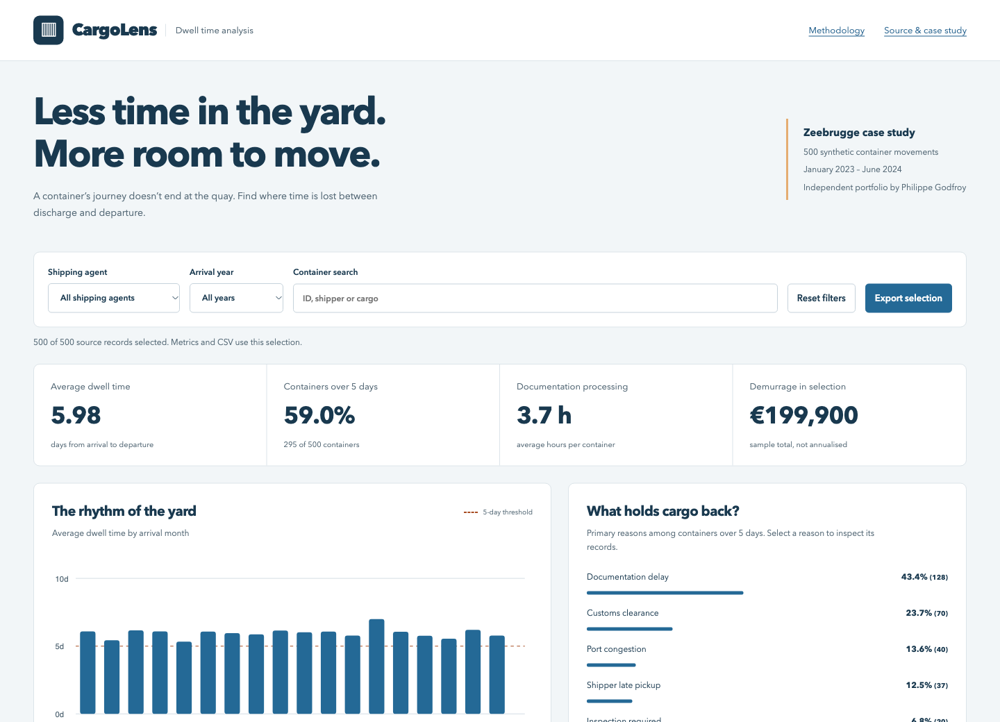
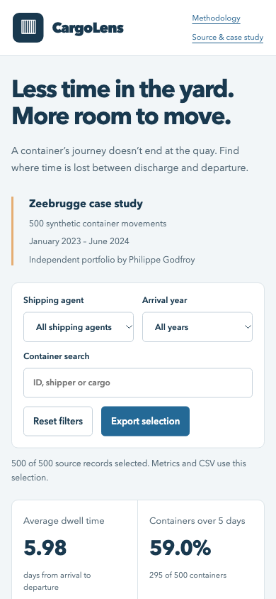

# CargoLens — Cargo dwell time analysis

[](https://github.com/phlppgdfry/cargo-dwell-time-analysis/actions/workflows/portfolio-pages.yml)

A reproducible business-analysis portfolio for a synthetic Zeebrugge container
terminal scenario. Explore the data, investigate delay causes and discuss
improvements without mistaking assumptions for measured results.

**[Open the interactive demo](https://phlppgdfry.github.io/cargo-dwell-time-analysis/)** · [Walkthrough](docs/PORTFOLIO.md) · [Verification](docs/VERIFICATION.md)



<details><summary>Mobile preview</summary>



</details>

## What you can explore

- Agent, arrival-year and text filters update every metric, chart and export.
- Monthly dwell trends and delay-reason drill-down lead to individual movements.
- A documentation-improvement slider models a clearly labelled sensitivity case.
- Paginated source records and CSV downloads make the calculations inspectable.
- Native HTML, CSS, JavaScript and SVG run without accounts or frontend packages.

## Reproduced sample results

| Metric | Movement-sheet result |
|---|---:|
| Containers | 500 |
| Average dwell | 5.982 days |
| Containers above five days | 295 (59.0%) |
| Sample demurrage total | €199,900 |
| Documentation-delayed containers | 128 of 295 delayed (43.4%) |

All results come from `Container_Movements` in the original workbook. The sample
is synthetic and is not actual terminal or shipping-agent performance data.
Figures in the workbook's summary sheets are illustrative and do not reconcile
to the movement sheet; the new dashboard deliberately computes from raw rows.

## Businesscase versus evidence

The historical case proposed a 6.4-day baseline, €2.1M annual cost, and a 25%
improvement target. These are planning assumptions, not findings reproduced by
this 500-row sample. No real interviews, sector benchmark validation or realised
savings are claimed. The original PDF is retained as a historical illustrative
businesscase; use the updated [executive summary](findings/executive-summary.md)
for the current, reconciled interpretation.

## Run and reproduce

```sh
python3 -m http.server 8000
# Open http://localhost:8000/demo/
```

To regenerate the public data or verify it against the workbook:

```sh
python3 -m pip install -r requirements-dev.txt
python3 scripts/export_data.py
python3 scripts/check_data.py
```

For PostgreSQL, load [the schema](sql/schema.sql), import the exported CSV,
then run [the analysis queries](sql/queries.sql). See [schema notes](sql/schema.md).

## Analyst deliverables

| Deliverable | Purpose |
|---|---|
| [Business requirements](BRD.md) | Scope, acceptance and evidence boundary |
| [Prioritised user stories](UserStories.md) | Testable requirements and exclusions |
| [As-is process](process/as-is-flow.svg) / [To-be process](process/to-be-flow.svg) | Illustrative improvement discussion |
| [Workbook](dashboards/analysis-data.xlsx) | Canonical movement source and historical narrative sheets |
| [Executive summary](findings/executive-summary.md) | Findings distinguished from assumptions |
| [Public dataset](demo/container_movements.csv) | Same 500 movement rows in an open format |

GitHub Actions checks the data export and publishes the credential-free demo.
Philippe Godfroy · Business analysis, logistics and software development.
MIT license; see [LICENSE](LICENSE).
